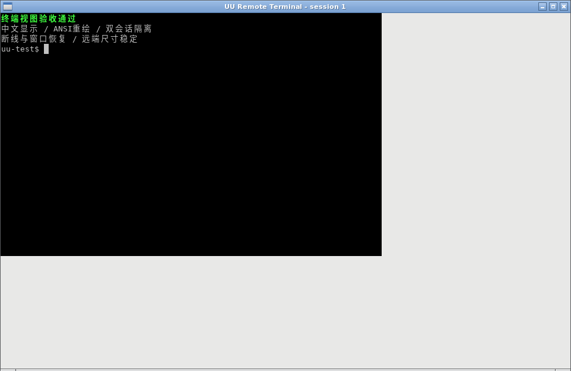

# Ubuntu 18.04 X11 与本机终端视图

本分支保留 Ubuntu 18.04 用户空间、系统 GLib/GTK/FFmpeg。默认 X11 被控端是目标；`inproc-av`、Wayland/portal、KMS 和实验 Linux 控制端不属于此兼容结论。

## 构建

```sh
sudo apt-get update
sudo apt-get install -y build-essential pkg-config curl ca-certificates \
  libx11-dev libxext-dev libxtst-dev libxfixes-dev libgtk-3-dev libvte-2.91-dev ffmpeg
# 使用 rustup 安装固定工具链；只改变当前用户的工具链，不升级系统组件。
rustup toolchain install 1.99.1 --profile minimal
cargo +1.99.1 test --locked
cargo +1.99.1 build --release --locked
ldd target/release/uuremote-server
```

图形登录依赖 `libgtk-3-0`；新增本机终端视图运行库为 `libvte-2.91-0`（由系统包管理器解析其依赖）。构建时安装开发包 `libvte-2.91-dev`，无需额外启动守护进程或安装 SSH/tmux。保留原系统 FFmpeg 3.4；初验指定 `UU_VIDEO_ENCODER=cpu UU_VIDEO_CODEC=h264`。

## 终端行为

沿用现有 session registry 和单个 PTY reader。远程 Terminal 的输入仅写入原 PTY；PTY 输出送入原远程通道及本机 VTE 窗口。渲染进程由同一二进制启动，只渲染字节，不启动另一份 shell。关闭回显的输入不会被额外显示。

远端决定 PTY 行列数，本机窗口变化不修改远端的 shell 尺寸。普通命令结束、DETACH 和连接断开后 shell/窗口保留；重新 OPEN 原 session 时复用。关闭本机窗口不结束任务，重新 OPEN 可恢复视图。CLOSE、KILL、显式 `exit` 保留既有结束语义；已退出 session 不会冒充活 session。持久性不跨服务/系统重启。

无可用图形显示或构建时缺少 VTE 时，原远程终端仍可用，日志会报告视图不可用。本机渲染滞后超过队列容量时关闭该视图，避免阻塞远程输出；重开时使用现有有界 scrollback。

## 验证记录

源码基线 `949acaac30f2319a0d90b7f5326657936248146e`，兼容修复 `ef33c21`，终端实现及本地验收 `db88199`。2026-10-19 一次性 WSL 实测：Ubuntu 18.04.6、glibc 2.27、GTK 3.22.30、GLib 2.56.4、VTE 0.52.2、FFmpeg 3.4.11、GCC 7.5.0、libstdc++6 8.4.0、Rust 1.99.1。

| 项目 | 实际结果 |
| --- | --- |
| 默认 X11 release / tests | `cargo build --release --locked` 通过；`cargo test --release --locked`：190 passed、0 failed、6 ignored |
| 动态库与 ABI | `ldd` 无缺失，GTK/VTE 均链接；最高直接 GLIBC_2.25，无直接 GLIBCXX 需求；GTK 登录与 VTE C 符号均存在 |
| 图形登录 | Bionic GTK 实际绘制；用户扫码确认，临时主机向云端同步为 ready。二维码和凭据没有导出 |
| 桌面编码 | Xvfb 1440×900，系统 FFmpeg 3.4 / libx264，5 帧、24506 bytes、首帧 IDR |
| 键鼠与剪贴板 | XTest→GTK motion/click/key 实际生效；双向 Unicode 剪贴板各 38 bytes |
| 音频 | 独立 Pulse null sink monitor→Opus，3 秒 86 包、399 bytes；这是静音虚拟源，不证明物理设备或客户端播放 |
| 同会话终端 | 真实 TerminalConn→原 PTY→VTE：中文/ANSI、120 行连续输出顺序及唯一性、stderr、Ctrl-C、关闭回显、远端 80×24→100×30→80×24、本机窗口缩放均通过 |
| 生命周期与隔离 | 两个 PTY/session/window 独立；DETACH、连接通道释放、重连、关闭/重开视图保留 PID/cwd/env；无害运行命令断线后完成；exit/CLOSE/KILL 与 LIST 状态通过 |
| 文件与端口映射 | 已有临时文件上传写块/确认、目录与压缩列表测试通过；新增 loopback TCP 真实 SYN/DATA 双向收发/FIN EOF 通过。未经过官方客户端网络通道 |
| 官方 Windows 客户端 | 原始 WSL 验收未完成官方客户端验证。后续车端日志确认桌面与首次创建终端成功，但非空会话列表触发客户端初始化失败；见下方修复记录 |

本机终端视图的实际 X11 截图（全部是合成验收内容）：



本地验收命令（先提供专用 Xvfb 与轻量窗口管理器；测试会注入键鼠，拒绝普通桌面）：

```sh
export DISPLAY=:99 GDK_BACKEND=x11 LC_ALL=C.UTF-8 LANG=C.UTF-8
UU_DESKTOP_BACKEND=x11 target/release/uuremote-server terminal-acceptance
UU_X11_ACCEPTANCE=1 UU_DESKTOP_BACKEND=x11 cargo test --release --locked \
  --bin uuremote-server x11_acceptance::actual_x11_input_and_clipboard -- --ignored --nocapture
```

UTF-8 locale 是 GTK Unicode 剪贴板探针的前提；`LC_ALL=C` 会使该探针失败。`terminal-acceptance` 创建真实临时 shell，结束后留下最终画面供查看；不登录云端。CI 的 Bionic job 在 `ubuntu:18.04` 用户空间执行构建、单测和 ABI 检查，上传二进制 artifact；本地 Xvfb 验收与官方客户端验收分别记录。

### Windows 非空终端列表修复（2026-10-19）

车端旧版日志：空列表后客户端发送 OPEN 并正常使用；保留一个会话后，客户端收到 LIST_RESP 便立即报断开，不再发送 OPEN。重启主机清空会话后首次创建恢复，说明首次创建成功不等于重连成功。

只读检查官方 Windows UU 4.42.0.2770 的 `terminal_management_model.cpp` 解析路径：每条记录都必须包含整数 `last_active_ms`（读取地址 `0x1410a209a`）和 `created_at_ms`，缺字段走解析失败分支。上游沿用的列表应答缺 `last_active_ms`；此次 VTE 改动没有修改该应答。现已补字段，创建时初始化，PTY 输出、输入、OPEN/RESIZE/SIGNAL/DETACH 时更新；不记录终端内容。

验证：新增必需字段断言在旧实现失败；修复后 Ubuntu 18.04 release 单测 190 passed、0 failed、6 ignored，默认 X11 release 构建通过。专用 Xvfb/Openbox 下真实 PTY/VTE 验收通过，包括非空列表字段校验、DETACH/重连、通道释放、多会话、关闭/重开视图、关闭回显及 exit/CLOSE/KILL。启动验收前等待窗口管理器就绪，并设置 `NO_AT_BRIDGE=1`，避免 WSL 图形环境干扰。

同日经用户授权将修复 `ec23703` 替换到车端独立 release 目录，保留旧版及回退路径；未改变系统包或自启配置。安装文件与运行中进程 SHA256 均为 `5cc836bf22d1e5cab064074c922b5f15f91cd2aa3f5f2fd1d11f4e4cabe9f150`，车端 `ldd` 无缺失，重启后服务 enabled/running、云端 ready、SSH 正常。官方 Windows 客户端的保留会话重连仍待用户验收，不能由服务在线状态替代。

### Windows 会话管理终止修复（2026-10-19）

上一项修复安装后，车端收到 Windows 的 KILL_REQ（type 11），header 与前一条 LIST_REQ 相同，为管理请求编号，JSON payload 为 16 字节；当时实际活会话只有 `1`、`2`。原实现优先将非零 header 当目标，因此用户多次点击“终止”都未结束 shell。先前验收只覆盖空 payload、header 直接指定目标的方式，未覆盖 Windows 的管理请求方式。

只读核对当前官方 Windows UU 4.43.0.3607：`terminal_management_model` 的 KILL_REQ 构造路径（`0x1410bcfc6` 至 `0x1410bd0ea`）将 `session_id` 放入 JSON；KILL_RESP 分支（`0x1410bf2de`）使用 `code/message` 解析器（`0x1410bf840`）。修复为非空 payload 严格解析非零 u32 目标，非法或溢出时直接拒绝，不回退到 header；空 payload 保留旧客户端方式。所有 KILL_RESP 回显请求 header。

定向回归使用两个真实 PTY，让请求编号恰好等于另一活会话编号，检查只结束 JSON 指定的目标、目标被回收且从列表移除、另一 shell 存活，并覆盖畸形/缺失/零/负数/浮点/字符串/溢出 ID 和旧方式。新增测试在旧实现失败，原因是目标 shell 未被终止。`terminal-acceptance` 的一条 KILL 路径也改为 Windows 请求格式，另一条仍验收旧格式。

修复后 Ubuntu 18.04 release 单测 191 passed、0 failed、6 ignored，默认 X11 release 构建通过。真实 PTY/VTE 验收通过，包括 Windows 格式终止目标后另一会话继续显示，以及列表回收、断线重连、窗口恢复、中文/ANSI、尺寸锁定、关闭回显和 exit/CLOSE/旧格式 KILL。构建直接引用的最高 glibc 版本为 GLIBC_2.25，GTK/VTE 运行库解析正常；官方客户端点击“终止”仍需车端验收。

同日将修复 `fcbc353` 安装到车端独立 release 目录，保留上一版 `ec23703` 供回退，沿用现有配置与自启服务。安装文件和运行中进程的 SHA256 均为 `b14bef91fbeaae498fe15f3efcc9b81619a6bcb1a929cb728c13a03d96d2a902`，车端 `ldd` 无缺失；重启后服务 enabled/running、NRestarts=0、云端 ready、SSH 正常。尚待用户用官方 Windows 客户端验收目标终止及另一会话继续工作。

## 车端部署步骤

1. 在车端只读核对当前会话、既有服务和二进制路径；不要硬编码其它机器的 DISPLAY/XAUTHORITY。保留 Ubuntu、glibc、ROS、Python、FFmpeg 和 NoMachine。
2. 获得部署授权后，安装缺少的系统运行库（尤其 `libvte-2.91-0`）。先把本次 Bionic 构建的二进制传到临时路径，运行 `ldd`，确认无缺失库。
3. 在没有远程任务时备份现有二进制，将新文件复制为目标同目录临时文件，`chmod 755` 后 `mv -f` 原子替换。重启现有用户服务会结束正在运行的 UU session，应选择空闲时段。
4. 沿用该用户真实 X11 会话的 DISPLAY、XAUTHORITY 和用户总线。保留 GTK 登录，通过官方 Windows UU 客户端验证桌面、键鼠、声音、剪贴板、文件、Terminal 和端口映射。
5. Terminal 验收使用无敏感内容的变量、工作目录和 shell PID，检查断线/重连、多 session、Ctrl-C、关闭回显、关闭本机窗口、显式 exit/KILL；不把本地探针当作官方客户端验收。

WSL 结果不能证明车端 Intel 硬件编码、真实音频设备、GNOME/Xauthority、开机启动和机器人依赖；这些需要授权后上车验证。

## 一次性环境

本机新建发行版名 `uu-bionic-test`，安装目录 `F:\Virtual\uu-bionic-test`。未改默认发行版、现有发行版或全局 `.wslconfig`。

Rootfs 来源：[Canonical Bionic core archive](https://partner-images.canonical.com/core/bionic/current/)，文件 `ubuntu-bionic-core-cloudimg-amd64-root.tar.gz`，与同目录 SHA256SUMS 校验一致：

```
d44096a712fee7dc69ea0ad67d90e1364622488cdd58b1407fac135dc942a8d2
```

使用微软支持的 [wsl --import](https://learn.microsoft.com/en-us/windows/wsl/basic-commands#import-a-distribution) 导入为 WSL2。源码和构建位于发行版 Linux 文件系统 `/root/uu-remote-linux`。

交付物导出后可按需仅销毁此发行版（本任务不自动执行）：

```powershell
wsl --terminate uu-bionic-test
wsl --unregister uu-bionic-test
```

注销会永久删除该临时发行版及其中的进程/文件。不要把命令中的名称改成已有发行版。

